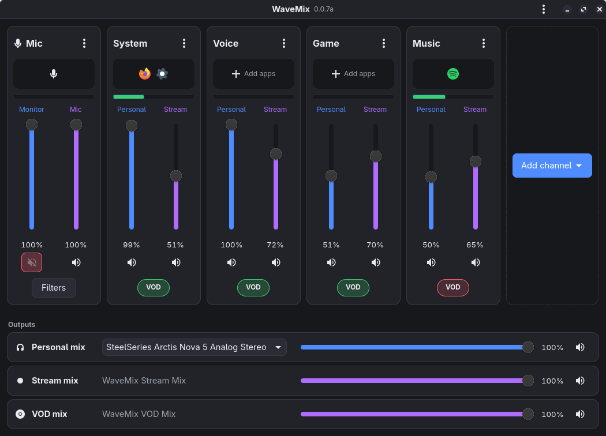
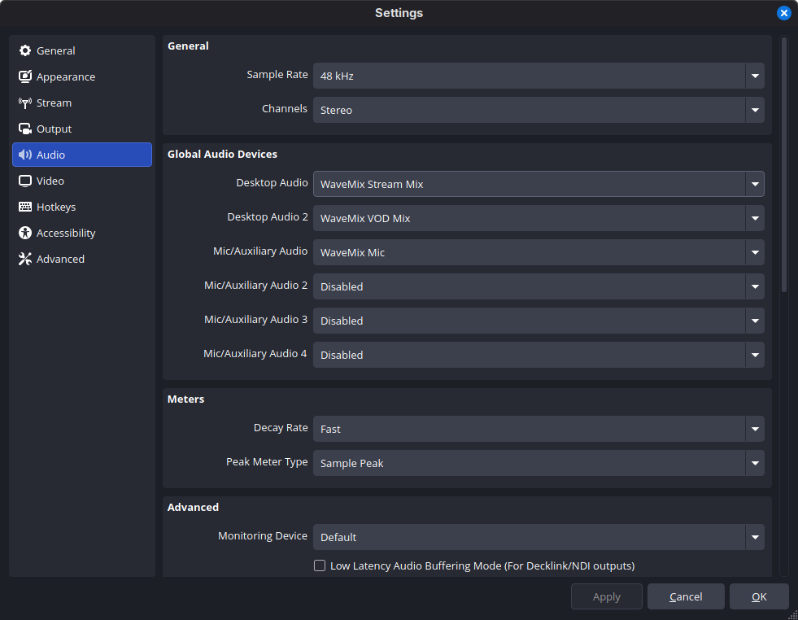

<h1 align="center">

<br>
WaveMix
<br>
<a href="#"></a> <a href="#"></a>
</h1>

**An audio mixer for streamers on Linux.** Put your apps in channels, give each one a volume for you and a volume for your stream, and run your mic through its own filters, all in one window. OBS records the mixes and the mic as ordinary audio devices.



## Features

- **Two sliders per channel** – *Personal* (what you hear) and *Stream* (what your stream hears).
- **Channels for your apps** – Game, Voice, Music and more; tick an app once and it goes back there every time.
- **A mic with real filters** – noise removal, EQ, compressor, gate and more, in any order, tuned live.
- **A separate VOD mix** – leave copyrighted music out of your VOD track and keep it on stream.
- **Channel meters** – see at a glance whether sound is reaching each channel and your mic.
- **Made for OBS** – one device for your stream, one for your mic, ready from the moment you log in.
- **Themes** – Dark, Light, Midnight and High Contrast, or style it yourself with CSS.

## Development status

WaveMix is in alpha. It's usable, but expect bugs and changes between versions. Bug reports and feedback help a lot (see [Reporting a problem](#reporting-a-problem)).

See the [roadmap](roadmap.md) for what's planned next.

## Requirements

- **PipeWire** 1.0 or newer, with **pipewire-pulse** and **WirePlumber** running (most current distributions use them already)
- **gtkmm 4.12** or newer
- For the mic's filters: **RNNoise**, the **LADSPA SDK** and **LSP plugins**, as LADSPA plugins

## Installation

### Arch Linux

WaveMix isn't on the AUR yet. Until it is, build the package from this repository:

```bash
git clone https://github.com/ChromieVT/wavemix.git
cd wavemix
makepkg -si
```

### From source

You'll also need Meson 1.1+, a C++20 compiler (GCC 11+ or Clang 14+), libpulse, GLib 2.70+, gdk-pixbuf and nlohmann/json 3.10+.

```bash
meson setup build --prefix=/usr
meson compile -C build
sudo meson install -C build
```

## Using it with OBS

> [!TIP]
> Make WaveMix OBS's **global audio** (**Settings → Audio**), so every scene gets it automatically, with no sources to add or keep track of.

| Global Audio Device | WaveMix Device |
|---|---|
| Desktop Audio | **WaveMix Stream Mix** |
| Desktop Audio 2 (VOD track, if you use the VOD Mix) | **WaveMix VOD Mix** |
| Mic/Auxiliary Audio | **WaveMix Mic** |



## Reporting a problem

Run `wavemix --bug-report > wavemix-report.txt` (or ☰ → **Save a bug report…** in the window) and attach the file to a [new issue](https://github.com/ChromieVT/wavemix/issues). Your home folder is hidden in it.


## License

This project is licensed under GPL-3.0-or-later. See [LICENSE](LICENSE) for details.


**Last updated:** 3 November 2026
